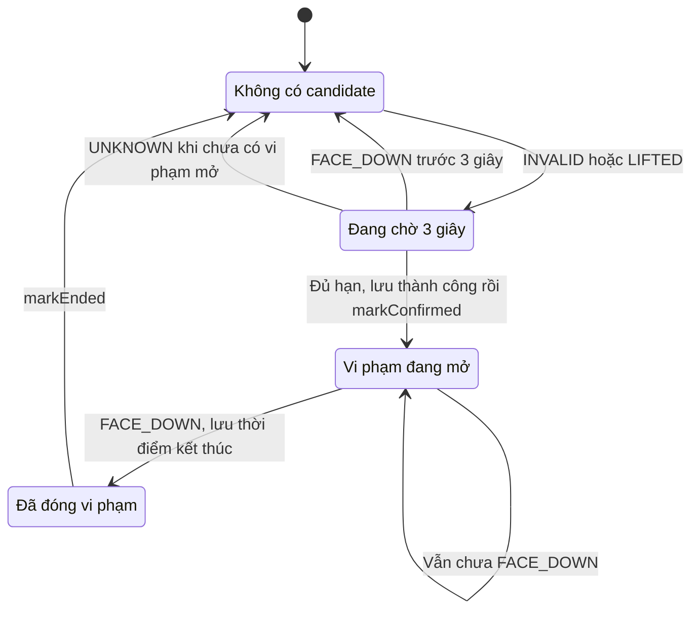

# STM-02 — Vòng đời xác nhận vi phạm

Các nhãn Idle/Grace/Open/Closed là trạng thái phân tích của engine, không phải enum lưu trong SQLite. FACE_DOWN sau hạn cần xác nhận rồi đóng.

Nguồn đối chiếu: [feature-specification.md](../../feature-specification.md), [decisions/ADR-008-platform-session-lifecycle.md](../../decisions/ADR-008-platform-session-lifecycle.md).
