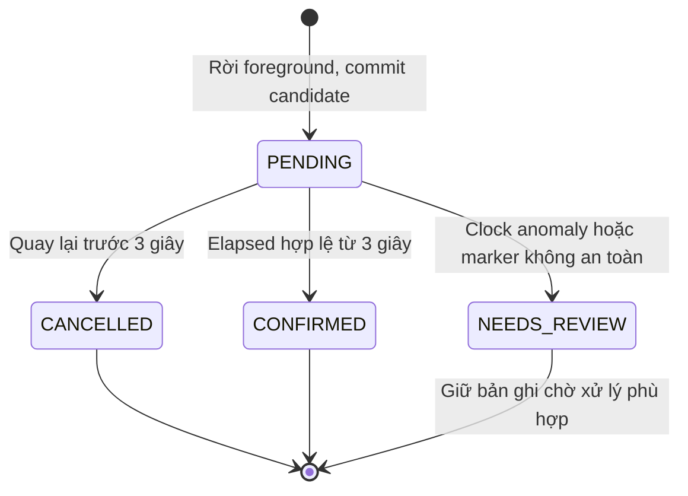

# STM-03 — Candidate lifecycle bền vững

Không vẽ NEEDS_REVIEW tự chuyển sang CONFIRMED khi chưa có hợp đồng xử lý. CONFIRMED liên kết cùng UUID với vi phạm để chống trùng.

Nguồn đối chiếu: [decisions/ADR-008-platform-session-lifecycle.md](../../decisions/ADR-008-platform-session-lifecycle.md).
