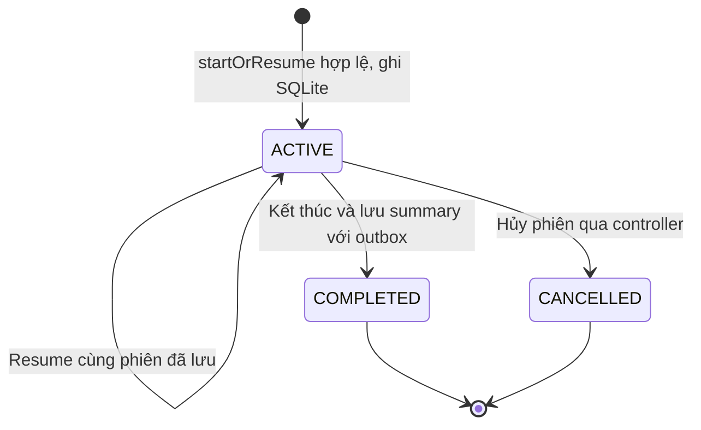

# STM-04 — Phiên Solo

Sơ đồ luồng runtime Solo; schema hỗ trợ CREATED nhưng không coi đó là bước bắt buộc của startOrResume hiện tại. Trạng thái đồng bộ được vẽ riêng.

Nguồn đối chiếu: [product-requirements.md](../../product-requirements.md), [decisions/ADR-030-solo-direct-summary-sync.md](../../decisions/ADR-030-solo-direct-summary-sync.md).
