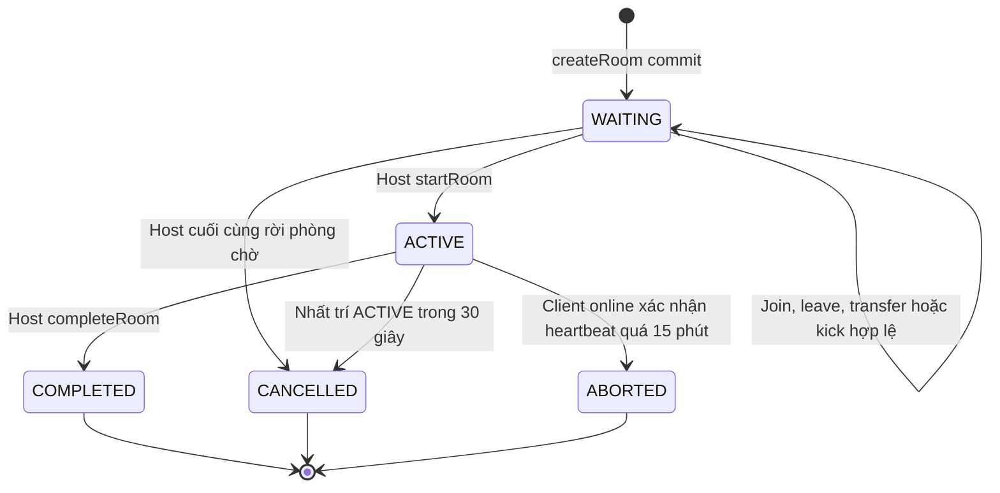

# STM-05 — Vòng đời phòng

Không có scheduler tự chuyển ABORTED trên Spark. Nếu mọi thiết bị offline, chuyển trạng thái chỉ xảy ra khi client đủ điều kiện kết nối lại.

Nguồn đối chiếu: [api-contracts.md](../../api-contracts.md), [decisions/ADR-019-spark-stale-room-abort.md](../../decisions/ADR-019-spark-stale-room-abort.md), [decisions/ADR-026-spark-lobby-leave-host-transfer.md](../../decisions/ADR-026-spark-lobby-leave-host-transfer.md).
