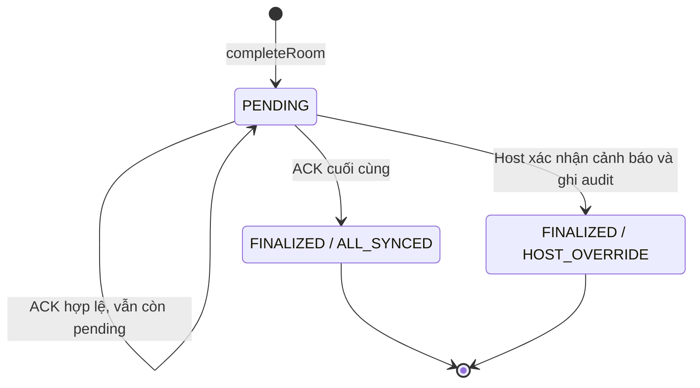

# STM-06 — Đối soát và chốt điểm

ALL_SYNCED và HOST_OVERRIDE là finalizationReason; FINALIZED là reconciliationStatus. Điểm đã chốt không được sửa bởi sự kiện muộn.

Nguồn đối chiếu: [decisions/ADR-017-spark-room-completion.md](../../decisions/ADR-017-spark-room-completion.md), [decisions/ADR-018-spark-host-finalization-override.md](../../decisions/ADR-018-spark-host-finalization-override.md).
