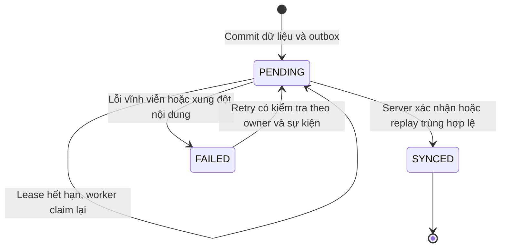

# STM-07 — Trạng thái hàng đợi đồng bộ

Lease không tạo trạng thái SENDING mới. Không retry vô hạn lỗi schema/quyền; retry thủ công tuân thủ hợp đồng từng loại sự kiện.

Nguồn đối chiếu: [architecture.md](../../architecture.md), [decisions/ADR-030-solo-direct-summary-sync.md](../../decisions/ADR-030-solo-direct-summary-sync.md).
