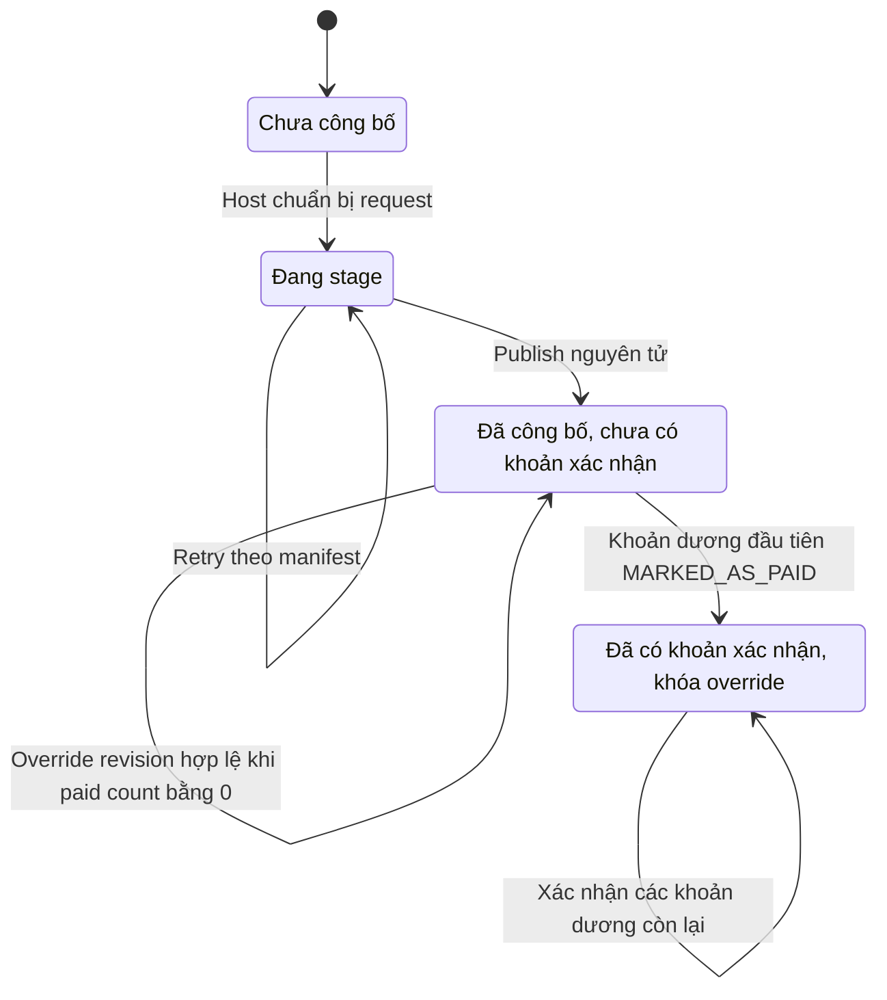

# STM-08 — Công bố bill và trạng thái khoản trả

Đây là trạng thái nghiệp vụ suy ra từ manifest, revision và billPaidCount; không phải một enum billStatus duy nhất. Share riêng đổi UNPAID sang MARKED_AS_PAID; share 0 không cần trả.

Nguồn đối chiếu: [decisions/ADR-021-spark-default-bill.md](../../decisions/ADR-021-spark-default-bill.md), [decisions/ADR-022-spark-bill-overrides.md](../../decisions/ADR-022-spark-bill-overrides.md), [decisions/ADR-023-spark-manual-payment-status.md](../../decisions/ADR-023-spark-manual-payment-status.md).
