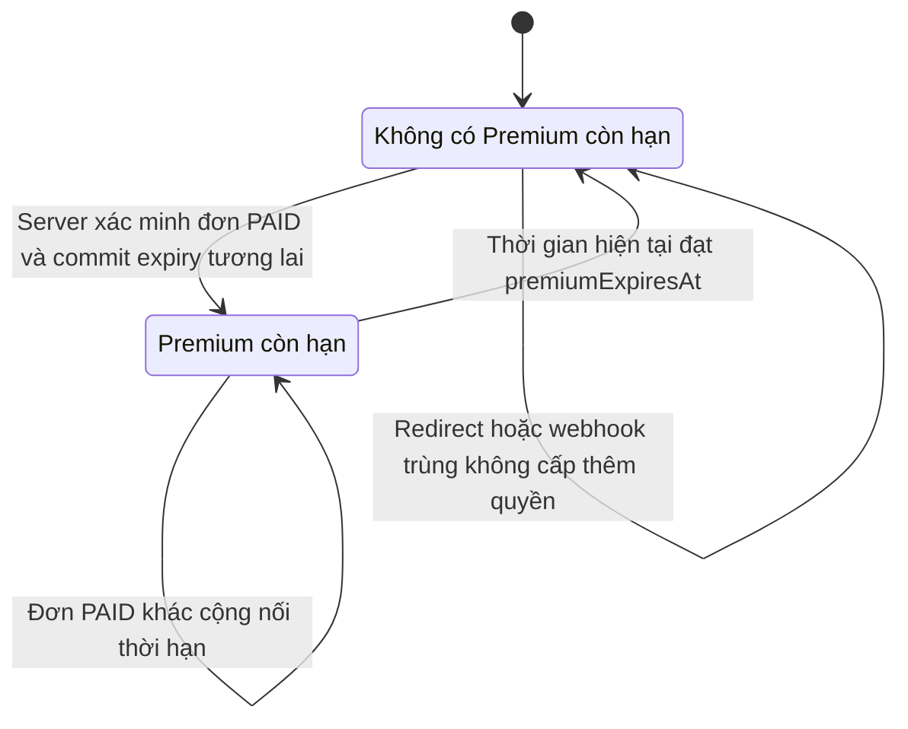

# STM-09 — Quyền Premium theo thời gian

Trạng thái quyền được suy ra từ premiumExpiresAt; không cần scheduler đổi boolean khi hết hạn. Không dùng kích hoạt checksum offline cũ.

Nguồn đối chiếu: [decisions/ADR-025-payos-expiring-premium.md](../../decisions/ADR-025-payos-expiring-premium.md), [api-contracts.md](../../api-contracts.md).
