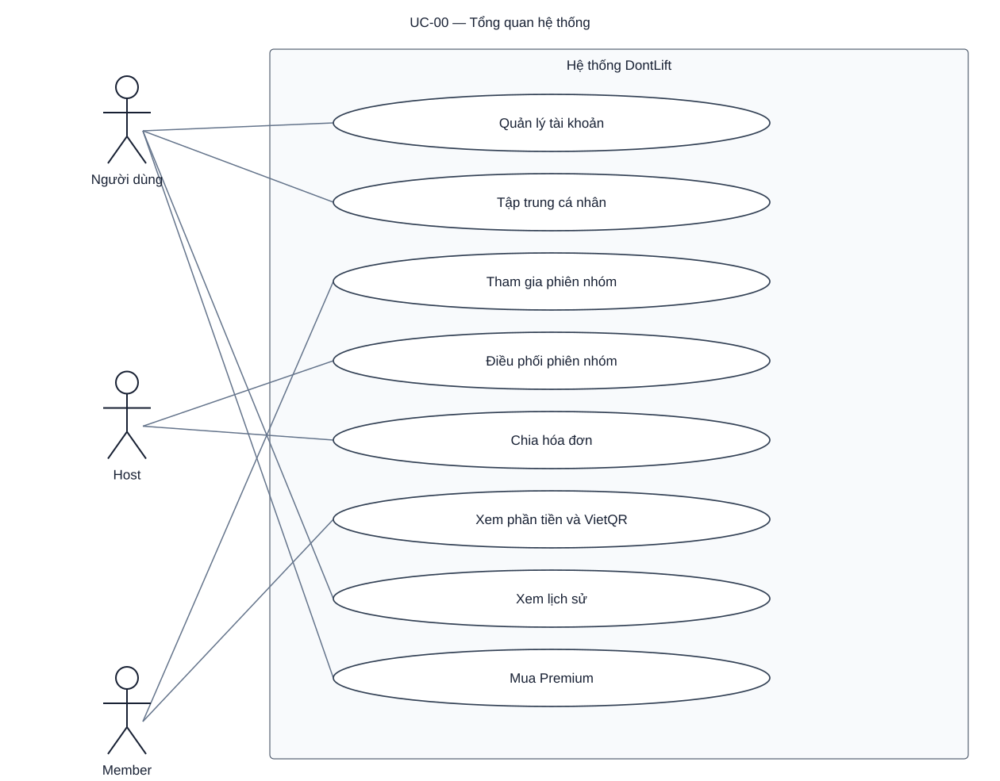

# UC-00 — Tổng quan hệ thống

Sơ đồ phân rã chức năng mức tổng quan. Host và Member là vai trò theo từng phòng, đều là người dùng; không có vai trò Admin hoặc chức năng chat trong phạm vi này.

[File PlantUML có thể chỉnh sửa](uc-00-tong-quan.puml). SVG được tạo cục bộ từ cùng mô hình tác nhân, Use Case và quan hệ; không phải ảnh xuất bởi PlantUML.

| Mã | Use Case |
|---|---|
| G01 | Quản lý tài khoản |
| G02 | Tập trung cá nhân |
| G03 | Tham gia phiên nhóm |
| G04 | Điều phối phiên nhóm |
| G05 | Chia hóa đơn |
| G06 | Xem phần tiền và VietQR |
| G07 | Xem lịch sử |
| G08 | Mua Premium |

Đường liền biểu diễn tương tác. Mũi tên nét đứt `include` đi từ chức năng chính đến chức năng bắt buộc; `extend` đi từ phần mở rộng đến chức năng gốc. Điều kiện trước như đăng nhập không tự động được vẽ thành `include`.

Nguồn đối chiếu: [product-requirements.md](../../product-requirements.md), [feature-specification.md](../../feature-specification.md).
