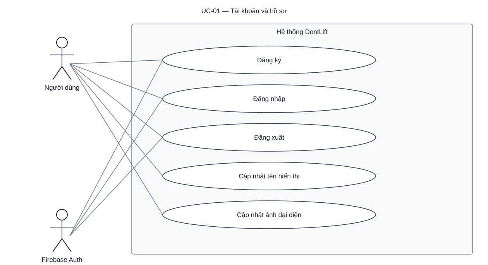

# UC-01 — Tài khoản và hồ sơ

Đăng nhập email/mật khẩu. Không đưa đăng nhập mạng xã hội hay khôi phục mật khẩu trong kế hoạch tương lai vào sơ đồ hiện tại.

[File PlantUML có thể chỉnh sửa](uc-01-tai-khoan.puml). SVG được tạo cục bộ từ cùng mô hình tác nhân, Use Case và quan hệ; không phải ảnh xuất bởi PlantUML.

| Mã | Use Case |
|---|---|
| AUTH01 | Đăng ký |
| AUTH02 | Đăng nhập |
| AUTH03 | Đăng xuất |
| AUTH04 | Cập nhật tên hiển thị |
| AUTH05 | Cập nhật ảnh đại diện |

Đường liền biểu diễn tương tác. Mũi tên nét đứt `include` đi từ chức năng chính đến chức năng bắt buộc; `extend` đi từ phần mở rộng đến chức năng gốc. Điều kiện trước như đăng nhập không tự động được vẽ thành `include`.

Nguồn đối chiếu: [product-requirements.md](../../product-requirements.md), [decisions/ADR-010-expo-go-firebase-js.md](../../decisions/ADR-010-expo-go-firebase-js.md), [api-contracts.md](../../api-contracts.md).
