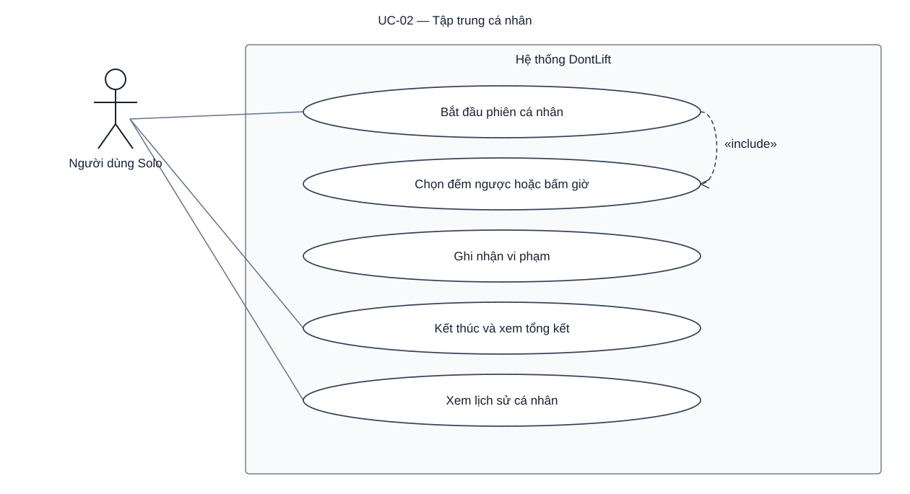

# UC-02 — Tập trung cá nhân

Ghi nhận vi phạm là hành vi tự động có điều kiện trong phiên, không phải thao tác do người dùng chủ động gọi. Đồng bộ là xử lý nội bộ, được mô tả ở Sequence.

[File PlantUML có thể chỉnh sửa](uc-02-solo.puml). SVG được tạo cục bộ từ cùng mô hình tác nhân, Use Case và quan hệ; không phải ảnh xuất bởi PlantUML.

| Mã | Use Case |
|---|---|
| SOLO01 | Bắt đầu phiên cá nhân |
| SOLO02 | Chọn đếm ngược hoặc bấm giờ |
| SOLO03 | Ghi nhận vi phạm |
| SOLO04 | Kết thúc và xem tổng kết |
| SOLO05 | Xem lịch sử cá nhân |

Đường liền biểu diễn tương tác. Mũi tên nét đứt `include` đi từ chức năng chính đến chức năng bắt buộc; `extend` đi từ phần mở rộng đến chức năng gốc. Điều kiện trước như đăng nhập không tự động được vẽ thành `include`.

Nguồn đối chiếu: [product-requirements.md](../../product-requirements.md), [feature-specification.md](../../feature-specification.md), [decisions/ADR-030-solo-direct-summary-sync.md](../../decisions/ADR-030-solo-direct-summary-sync.md).
