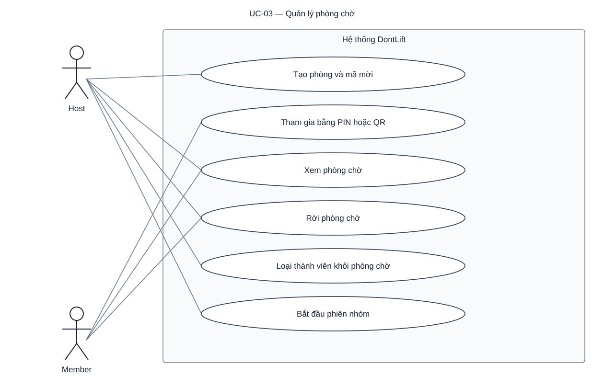

# UC-03 — Quản lý phòng chờ

Rời phòng chờ và loại thành viên chỉ áp dụng WAITING. Host rời phòng có thể chuyển quyền; loại thành viên không tạo lệnh cấm tham gia vĩnh viễn.

[File PlantUML có thể chỉnh sửa](uc-03-phong-cho.puml). SVG được tạo cục bộ từ cùng mô hình tác nhân, Use Case và quan hệ; không phải ảnh xuất bởi PlantUML.

| Mã | Use Case |
|---|---|
| ROOM01 | Tạo phòng và mã mời |
| ROOM02 | Tham gia bằng PIN hoặc QR |
| ROOM03 | Xem phòng chờ |
| ROOM04 | Rời phòng chờ |
| ROOM05 | Loại thành viên khỏi phòng chờ |
| ROOM06 | Bắt đầu phiên nhóm |

Đường liền biểu diễn tương tác. Mũi tên nét đứt `include` đi từ chức năng chính đến chức năng bắt buộc; `extend` đi từ phần mở rộng đến chức năng gốc. Điều kiện trước như đăng nhập không tự động được vẽ thành `include`.

Nguồn đối chiếu: [product-requirements.md](../../product-requirements.md), [decisions/ADR-026-spark-lobby-leave-host-transfer.md](../../decisions/ADR-026-spark-lobby-leave-host-transfer.md), [decisions/ADR-027-spark-lobby-member-removal.md](../../decisions/ADR-027-spark-lobby-member-removal.md).
