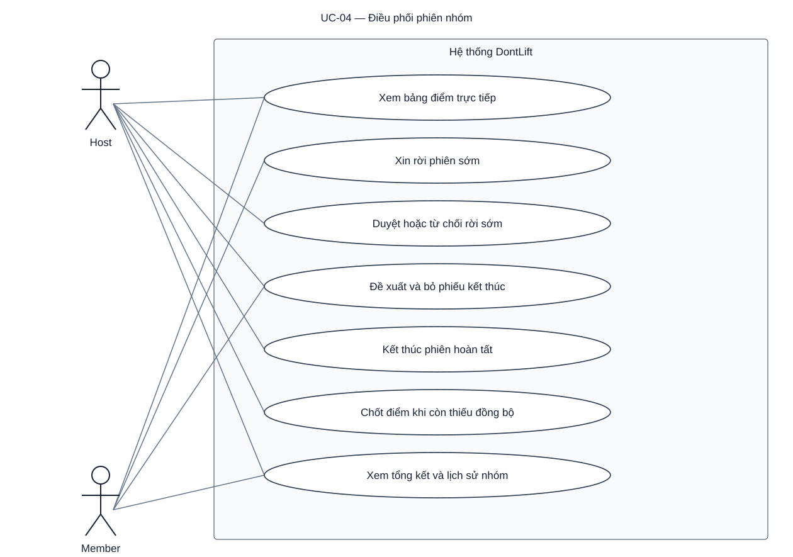

# UC-04 — Điều phối phiên nhóm

Bỏ phiếu hủy cần nhất trí của toàn bộ thành viên ACTIVE trong 30 giây. Hoàn tất phiên và hủy phiên có kết quả nghiệp vụ khác nhau.

[File PlantUML có thể chỉnh sửa](uc-04-phien-nhom.puml). SVG được tạo cục bộ từ cùng mô hình tác nhân, Use Case và quan hệ; không phải ảnh xuất bởi PlantUML.

| Mã | Use Case |
|---|---|
| GROUP01 | Xem bảng điểm trực tiếp |
| GROUP02 | Xin rời phiên sớm |
| GROUP03 | Duyệt hoặc từ chối rời sớm |
| GROUP04 | Đề xuất và bỏ phiếu kết thúc |
| GROUP05 | Kết thúc phiên hoàn tất |
| GROUP06 | Chốt điểm khi còn thiếu đồng bộ |
| GROUP07 | Xem tổng kết và lịch sử nhóm |

Đường liền biểu diễn tương tác. Mũi tên nét đứt `include` đi từ chức năng chính đến chức năng bắt buộc; `extend` đi từ phần mở rộng đến chức năng gốc. Điều kiện trước như đăng nhập không tự động được vẽ thành `include`.

Nguồn đối chiếu: [product-requirements.md](../../product-requirements.md), [decisions/ADR-015-spark-early-exit.md](../../decisions/ADR-015-spark-early-exit.md), [decisions/ADR-016-spark-termination-vote.md](../../decisions/ADR-016-spark-termination-vote.md), [decisions/ADR-018-spark-host-finalization-override.md](../../decisions/ADR-018-spark-host-finalization-override.md).
