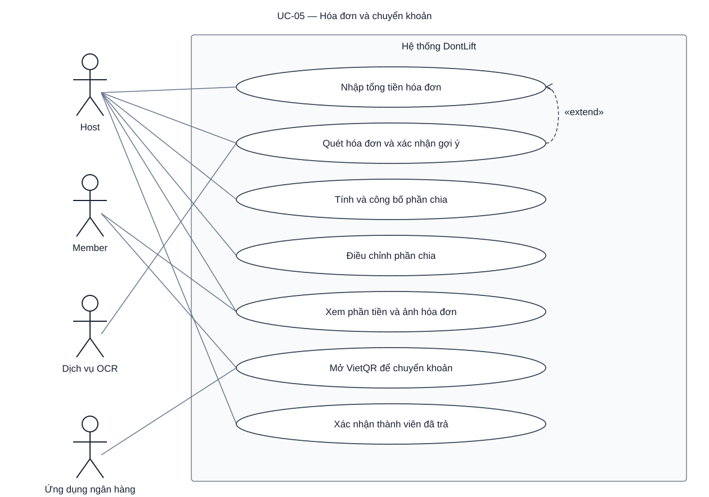

# UC-05 — Hóa đơn và chuyển khoản

OCR là phần mở rộng tùy chọn khi nhập tổng tiền, dành cho Host Premium còn hạn. Chia tiền dựa trên điểm đã chốt; trạng thái đã trả do Host xác nhận thủ công.

[File PlantUML có thể chỉnh sửa](uc-05-hoa-don.puml). SVG được tạo cục bộ từ cùng mô hình tác nhân, Use Case và quan hệ; không phải ảnh xuất bởi PlantUML.

| Mã | Use Case |
|---|---|
| BILL01 | Nhập tổng tiền hóa đơn |
| BILL02 | Quét hóa đơn và xác nhận gợi ý |
| BILL03 | Tính và công bố phần chia |
| BILL04 | Điều chỉnh phần chia |
| BILL05 | Xem phần tiền và ảnh hóa đơn |
| BILL06 | Mở VietQR để chuyển khoản |
| BILL07 | Xác nhận thành viên đã trả |

Đường liền biểu diễn tương tác. Mũi tên nét đứt `include` đi từ chức năng chính đến chức năng bắt buộc; `extend` đi từ phần mở rộng đến chức năng gốc. Điều kiện trước như đăng nhập không tự động được vẽ thành `include`.

Nguồn đối chiếu: [api-contracts.md](../../api-contracts.md), [decisions/ADR-021-spark-default-bill.md](../../decisions/ADR-021-spark-default-bill.md), [decisions/ADR-022-spark-bill-overrides.md](../../decisions/ADR-022-spark-bill-overrides.md), [decisions/ADR-023-spark-manual-payment-status.md](../../decisions/ADR-023-spark-manual-payment-status.md).
