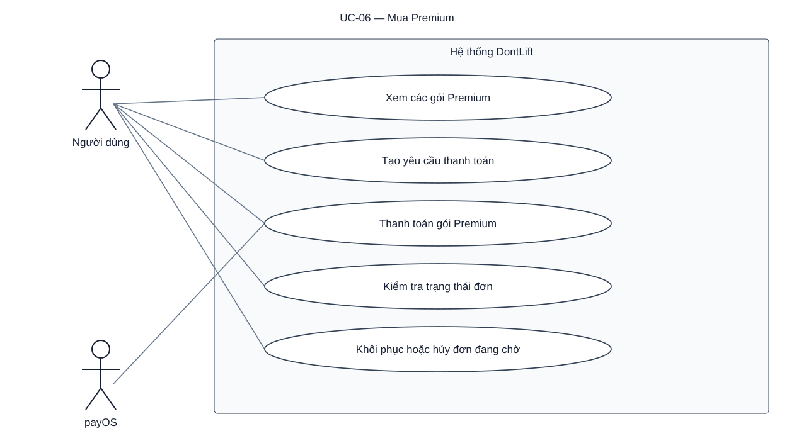

# UC-06 — Mua Premium

Premium có thời hạn, không tự gia hạn. Webhook xác minh và cấp quyền là luồng kỹ thuật ở Sequence, không phải Use Case do payOS khởi tạo như người sử dụng DontLift.

[File PlantUML có thể chỉnh sửa](uc-06-premium.puml). SVG được tạo cục bộ từ cùng mô hình tác nhân, Use Case và quan hệ; không phải ảnh xuất bởi PlantUML.

| Mã | Use Case |
|---|---|
| PREM01 | Xem các gói Premium |
| PREM02 | Tạo yêu cầu thanh toán |
| PREM03 | Thanh toán gói Premium |
| PREM04 | Kiểm tra trạng thái đơn |
| PREM05 | Khôi phục hoặc hủy đơn đang chờ |

Đường liền biểu diễn tương tác. Mũi tên nét đứt `include` đi từ chức năng chính đến chức năng bắt buộc; `extend` đi từ phần mở rộng đến chức năng gốc. Điều kiện trước như đăng nhập không tự động được vẽ thành `include`.

Nguồn đối chiếu: [decisions/ADR-025-payos-expiring-premium.md](../../decisions/ADR-025-payos-expiring-premium.md), [api-contracts.md](../../api-contracts.md).
