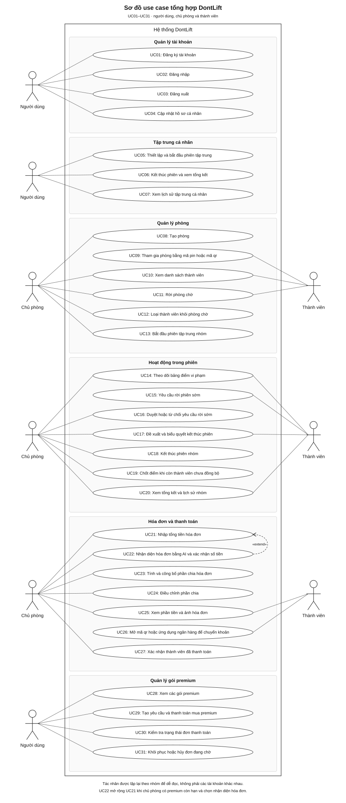

# Sơ đồ use case tổng hợp UC01–UC31

Sơ đồ này thống nhất với danh sách và 31 đặc tả use case trong báo cáo. Mọi chức năng nằm trong **một ranh giới hệ thống DontLift**. Sáu khung bên trong chỉ nhóm chức năng để dễ theo dõi.

[Mở ảnh SVG đầy đủ để phóng to](uc-07-toan-bo-31-use-case.svg) · [Ảnh PNG chèn vào báo cáo](uc-07-toan-bo-31-use-case.png) · [Nguồn PlantUML chỉnh sửa được](uc-07-toan-bo-31-use-case.puml)

## Tác nhân và quan hệ

- Người dùng thực hiện các chức năng tài khoản, tập trung cá nhân và premium.
- Chủ phòng và thành viên là vai trò của người dùng trong từng phòng; vẫn có các chức năng chung của người dùng. Tác nhân được vẽ lặp theo nhóm để giảm đường nối giao cắt.
- Mỗi ellipse là một use case, số hiệu UC01–UC31 giữ đúng danh sách đặc tả. UC04 gộp sửa tên và ảnh; UC05 bao gồm chọn bộ đếm; UC29 gộp tạo yêu cầu và thanh toán mua premium.
- Đường liền là liên kết tác nhân–use case. Mũi tên nét đứt UC22 → UC21 là `extend`: nhận diện hóa đơn là lựa chọn bổ sung khi nhập tổng tiền, có điều kiện premium còn hạn.
- Đăng nhập là điều kiện trước của các thao tác cần xác thực, không vẽ thành `include` cho mọi chức năng. Cảm biến và đồng bộ là xử lý bên trong, không thêm thành use case thứ 32.
- Đây là góc nhìn tác nhân con người. Firebase Auth, PaddleOCR, Cloudinary, payOS và ngân hàng được mô tả ở các sơ đồ tích hợp chi tiết đã có.

## Bảng đối chiếu với sơ đồ cũ

| Mã báo cáo | Use case | Tác nhân trực tiếp | Mã trong sơ đồ nhóm cũ |
|---|---|---|---|
| UC01 | Đăng ký tài khoản | người dùng | AUTH01 |
| UC02 | Đăng nhập | người dùng | AUTH02 |
| UC03 | Đăng xuất | người dùng | AUTH03 |
| UC04 | Cập nhật hồ sơ cá nhân | người dùng | AUTH04, AUTH05 |
| UC05 | Thiết lập và bắt đầu phiên tập trung | người dùng | SOLO01, SOLO02 |
| UC06 | Kết thúc phiên và xem tổng kết | người dùng | SOLO04 |
| UC07 | Xem lịch sử tập trung cá nhân | người dùng | SOLO05 |
| UC08 | Tạo phòng | chủ phòng | ROOM01 |
| UC09 | Tham gia phòng bằng mã pin hoặc mã qr | thành viên | ROOM02 |
| UC10 | Xem danh sách thành viên | chủ phòng, thành viên | ROOM03 |
| UC11 | Rời phòng chờ | chủ phòng, thành viên | ROOM04 |
| UC12 | Loại thành viên khỏi phòng chờ | chủ phòng | ROOM05 |
| UC13 | Bắt đầu phiên tập trung nhóm | chủ phòng | ROOM06 |
| UC14 | Theo dõi bảng điểm vi phạm | chủ phòng, thành viên | GROUP01 |
| UC15 | Yêu cầu rời phiên sớm | thành viên | GROUP02 |
| UC16 | Duyệt hoặc từ chối yêu cầu rời sớm | chủ phòng | GROUP03 |
| UC17 | Đề xuất và biểu quyết kết thúc phiên | chủ phòng, thành viên | GROUP04 |
| UC18 | Kết thúc phiên nhóm | chủ phòng | GROUP05 |
| UC19 | Chốt điểm khi còn thành viên chưa đồng bộ | chủ phòng | GROUP06 |
| UC20 | Xem tổng kết và lịch sử nhóm | chủ phòng, thành viên | GROUP07 |
| UC21 | Nhập tổng tiền hóa đơn | chủ phòng | BILL01 |
| UC22 | Nhận diện hóa đơn bằng AI và xác nhận số tiền | chủ phòng | BILL02 |
| UC23 | Tính và công bố phần chia hóa đơn | chủ phòng | BILL03 |
| UC24 | Điều chỉnh phần chia | chủ phòng | BILL04 |
| UC25 | Xem phần tiền và ảnh hóa đơn | chủ phòng, thành viên | BILL05 |
| UC26 | Mở mã qr hoặc ứng dụng ngân hàng để chuyển khoản | thành viên | BILL06 |
| UC27 | Xác nhận thành viên đã thanh toán | chủ phòng | BILL07 |
| UC28 | Xem các gói premium | người dùng | PREM01 |
| UC29 | Tạo yêu cầu và thanh toán mua premium | người dùng | PREM02, PREM03 |
| UC30 | Kiểm tra trạng thái đơn thanh toán | người dùng | PREM04 |
| UC31 | Khôi phục hoặc hủy đơn đang chờ | người dùng | PREM05 |

`SOLO03` (ghi nhận vi phạm) là hành vi tự động trong phiên, thể hiện ở Activity/Sequence; không phải một mục người dùng chủ động gọi trong danh sách 31 use case. Các mã cũ được giữ làm tham chiếu lịch sử, không dùng thay mã UC01–UC31 trong sơ đồ này.

## Nguồn và giới hạn

Đối chiếu [PRD](../../product-requirements.md), [đặc tả](../../feature-specification.md), [API](../../api-contracts.md), [sơ đồ nhóm](README.md) và các quyết định kiến trúc hiện hành. Quyền trong phòng, xử lý chốt điểm và giới hạn OCR tuân thủ các hợp đồng tương ứng; không thêm chức năng từ ảnh tham khảo.

SVG và PlantUML được tạo từ cùng mô hình bằng [script](../tools/build_full_usecase.py). SVG được bố trí cục bộ để dễ đọc trên GitHub, không phải ảnh xuất bằng PlantUML renderer. Sơ đồ là mô hình chức năng, không chứng nhận mọi tích hợp đã triển khai.

PNG là bản xuất Chrome tại thời điểm kiểm tra. Khi sửa mô hình, chạy lại build, dùng `render_check.mjs` và thay PNG bằng ảnh `use-case--uc-07-toan-bo-31-use-case.png` trong thư mục output.
